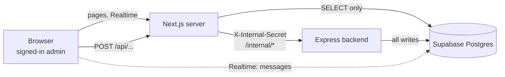

# Architecture: Dashboard

Companion: [`suryodaya-packers-movers-demo/ARCHITECTURE.md`](../suryodaya-packers-movers-demo/ARCHITECTURE.md). Last reviewed 4 November 2026 (dashboard `df6cb88`).

## 1. Role and trust boundary

- **Reads:** server components query Postgres directly through the `postgres` library in `lib/queries.ts`. Media use signed URLs created server-side (`lib/storage.ts`).
- **Writes:** none from the dashboard. Each action is a browser `fetch` to a Next route handler under `app/api/...`, which (1) checks the request **Origin**, (2) requires the signed-in Supabase user, (3) validates the body, then (4) forwards to Express with `X-Internal-Secret`. The secret exists only in server code.
- **Live chat:** the browser subscribes to Supabase Realtime on `messages`. That works because the backend's lockdown leaves `SELECT` on `messages` for the `authenticated` role and nothing else.
- **Auth:** Supabase Auth with a single admin and no sign-up. `proxy.ts` (the Next 16 name for middleware) refreshes the session on each request through `utils/supabase/proxy.ts`.

## 2. Rendering model

Pages are dynamic server components (`force-dynamic` where they call the backend) so each view reflects current data. Interactive parts are small client components (`"use client"`) that call the route handlers, show a status line, and call `router.refresh()` after a successful change.

## 3. Data access (`lib/`)

| File | Role |
|---|---|
| `queries.ts` | All Postgres reads: inbox, lead, messages, captures, touchpoints, alerts, survey, delivery failures. A missing table returns an empty list where a newer backend feature may not exist yet. |
| `internal-api.ts` | Typed `fetch` wrappers for the backend (quote, outreach, survey settings, automation, Instagram token). `cache: "no-store"`, secret header, `null` plus a message-only log on failure. |
| `origin.ts` | `isAllowedOrigin` for route handlers (forwarded host wins, port-aware, case-insensitive). |
| `inbox.ts`, `surveys.ts`, `captures.ts`, `contact-label.ts` | Pure view logic: filtering, grouping, labels. |
| `admin-alerts.ts`, `automation.ts`, `delivery.ts`, `instagram-token.ts`, `survey-settings.ts` | Pure labels, formatting and validation for their cards. Each has a `*.test.ts`. |

## 4. Feature map

| Feature | UI | Route handler(s) | Backend |
|---|---|---|---|
| Send as a human, takeover | chat panel | `/api/leads/[id]/send-message`, `/takeover` | `/internal/...` |
| Consent and manual follow-up | outreach panel | `/api/leads/[id]/outreach/consent`, `/followup` | outreach routes |
| Automated messages | automation panel | `/api/leads/[id]/automation/cancel` | `/internal/leads/:id/automation` |
| Survey settings | settings form | `/api/settings/survey`, `/reset` | `/internal/survey-settings` |
| Instagram token | token card, header banner | `/api/integrations/instagram/refresh` | `/internal/integrations/instagram` |
| Delivery problems | read-only card | none | reads `delivery_events` |

## 5. Conventions

- **Origin and auth first, then validation, then proxy.** Responses: `403` bad origin, `401` not signed in, `400` invalid body, pass-through of the backend's JSON for success and known client errors, `502` (`backend_unreachable`) for anything else.
- **Client-side validation is a convenience.** The backend is the authority (for example survey settings are re-validated strictly there); the form shows friendly messages for the backend's key names.
- **Times are India time**, formatted by pure helpers (`formatWhen`, `formatSurveyTime`) so they are testable.
- **Cards fail soft:** when the backend cannot be reached a card shows "unavailable" or hides; it never breaks the page.
- **Colours and states** come from small tone helpers (good, neutral, bad), not ad-hoc classes in components.

## 6. Adding a feature (checklist)

1. Backend: `/internal` route (and table, with the lockdown) in the Express repo.
2. `lib/internal-api.ts`: typed wrapper.
3. `lib/<feature>.ts` plus `lib/<feature>.test.ts` for labels and validation.
4. Route handler with Origin, user, validation, proxy and 502 handling.
5. Client or server component; add it to the page in the existing `Promise.all`, not as a sequential fetch.
6. `npm test`, `npm run lint`, `npm run build`, then a manual check.
